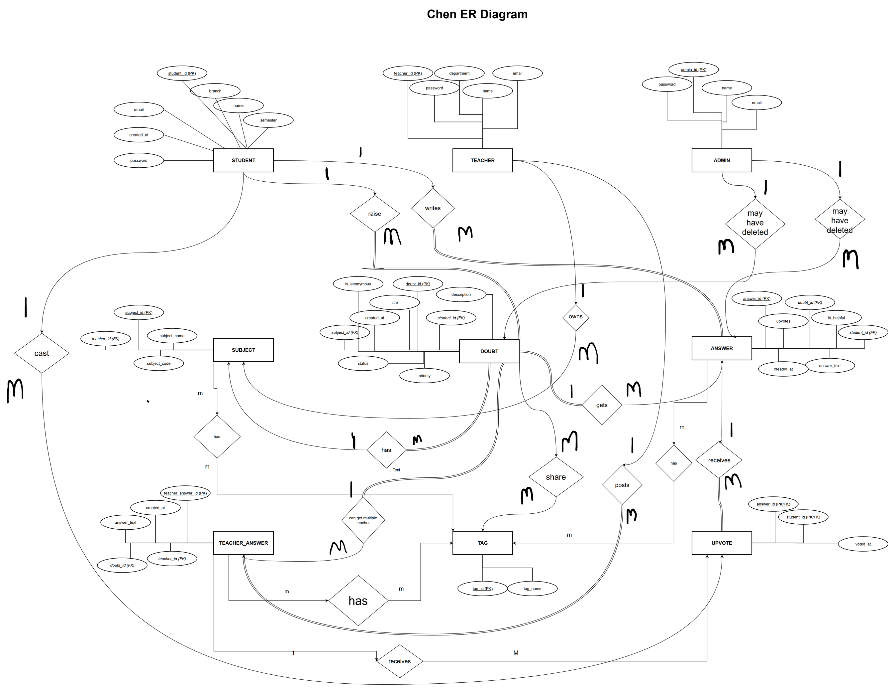
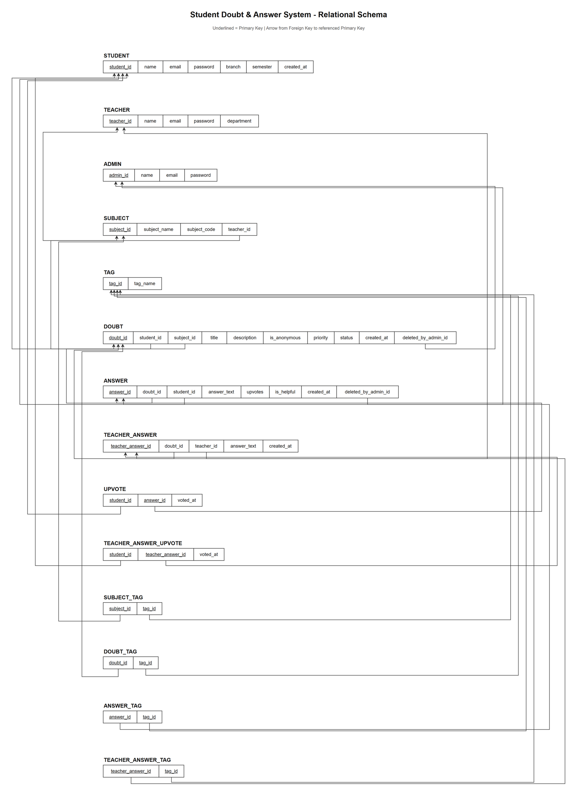

# Anonymous Classroom Doubt Portal

**PES University — Department of Computer Science and Engineering**  
**Database Management System (DBMS) — Experiential Learning Level 3 Mini Project**

An academic Q&A and doubt-resolution platform that lets students post doubts anonymously or openly, collaborate via peer explanations and upvotes, receive verified answers from faculty, and search related doubts using both MySQL Full-Text Search and MongoDB Cosine Vector Similarity.

---

## Key Features

- **Role-Based Authentication & Access Control (RBAC):** Real session/token authentication (`/api/auth/login`, `/logout`, `/me`) across **Student**, **Teacher**, and **Admin** roles, paired with granular MySQL 8.0 database roles (`role_portal_student`, `role_portal_teacher`, `role_portal_admin`).
- **14-Table Normalized Relational Schema (MySQL 8.0):**
  - Core entities: `student`, `teacher`, `admin`, `subject`, `tag`, `doubt`, `answer`, `teacher_answer`.
  - Composite-PK upvote & M:N tag tables: `upvote`, `teacher_answer_upvote`, `subject_tag`, `doubt_tag`, `answer_tag`, `teacher_answer_tag`.
  - Audit & integrity constraints: `deleted_by_admin_id` foreign keys on `doubt` and `answer`, `CHECK (semester BETWEEN 1 AND 8)`, `ENUM` workflow states, `ON DELETE CASCADE` / `ON DELETE SET NULL`, and `FULLTEXT INDEX` on `doubt(title, description)`.
- **Database Triggers, Stored Procedures & Functions:**
  - `trg_after_student_answer` & `trg_after_teacher_answer`: automatically update doubt lifecycle status on insert.
  - `trg_prevent_answer_on_closed_doubt` & `trg_prevent_teacher_answer_on_closed_doubt`: block new answers on `Closed` or moderated doubts using `SIGNAL SQLSTATE '45000'`.
  - `trg_after_upvote_insert` & `trg_after_upvote_delete`: keep cached `answer.upvotes` synchronized with the `upvote` table.
  - `sp_SubmitDoubt` (transactional doubt submission) & `sp_CloseDoubt`.
  - `fn_CalculateStudentReputation` powering the live CTE contributor leaderboard.
- **NoSQL Vector Store & Cosine Similarity Search (MongoDB):**
  - Deterministic 32-dimensional L2-normalized text embeddings (`VectorSearchService` & `04_nosql_setup.js`).
  - Full RUD operations (`/api/nosql/vectors/**`) + cosine similarity search (`/api/nosql/vectors/semantic?q=...`).
  - Automatic synchronization between MySQL and MongoDB on doubt creation, restoration, soft-delete, and hard purge.
- **Next.js App Router Frontend + Built-in Static Dashboard:**
  - Modern Next.js interface in `frontend/` (`localhost:3000`) plus updated login-to-dashboard static UI in Spring Boot (`localhost:8080`).

---

## Database Design Diagrams

### Chen ER Diagram


### Relational Schema (14 Tables)


---

## Tech Stack

| Layer | Technology | Purpose |
| :--- | :--- | :--- |
| Relational DBMS | MySQL 8.0 (InnoDB) | Core entities, constraints, triggers, procedures, CTEs, Full-Text Search, DB RBAC |
| NoSQL Vector Store | MongoDB + `mongosh` | `doubt_vectors` collection with 32-d embeddings, tags, and cosine similarity search |
| Backend API | Spring Boot 3.2 (Java 17) | REST endpoints, `JdbcTemplate`, Spring Data JPA & MongoDB, session RBAC |
| Primary Frontend | Next.js 15 (React 19, Tailwind CSS) | Multi-role student/faculty/admin portal with API proxy rewrite |
| Secondary Static UI | HTML5, Bootstrap 5, Vanilla JS | Embedded login & dashboard served directly by Spring Boot |

---

## Setup & Execution Guide

### 1. Initialize MySQL Database
Run the SQL scripts in order inside MySQL 8.0 (PowerShell-safe piping):
```powershell
Get-Content database/01_schema.sql -Raw | mysql -u root -p
Get-Content database/02_seed.sql -Raw | mysql -u root -p
Get-Content database/03_complex_queries.sql -Raw | mysql -u root -p
Get-Content database/05_rbac_privileges.sql -Raw | mysql -u root -p
```

### 2. Initialize MongoDB Vector Collection
Ensure MongoDB (`mongod`) is running on `localhost:27017`, then run:
```powershell
mongosh --file database/04_nosql_setup.js
```
*(Note: If local `mongod` is temporarily stopped, the Spring Boot service falls back gracefully to an in-memory vector store so the application remains usable.)*

### 3. Configure Local Backend Credentials
Copy the example properties file and enter your local MySQL password (kept out of git via `.gitignore`):
```powershell
Copy-Item src/main/resources/application-local.properties.example src/main/resources/application-local.properties
```

### 4. Run Spring Boot Backend (Port `8080`)
```powershell
.\apache-maven-3.9.6\bin\mvn.cmd spring-boot:run
```
Run integration tests:
```powershell
.\apache-maven-3.9.6\bin\mvn.cmd test
```

### 5. Run Next.js Frontend (Port `3000`)
```powershell
cd frontend
npm install
npm run dev
```
Open **`http://localhost:3000`** (or Spring Boot's built-in UI at `http://localhost:8080`).

---

## Demo Accounts (Seeded)

| Role | Name | Email | Password |
| :--- | :--- | :--- | :--- |
| Student | Rahul Sharma | `rahul@pes.edu` | `hashed_pwd_1` |
| Student | Ananya Rao | `ananya@pes.edu` | `hashed_pwd_2` |
| Student | Vikram Verma | `vikram@pes.edu` | `hashed_pwd_3` |
| Teacher | Dr. Sudhir Kumar | `sudhir@pes.edu` | `prof_pwd_1` |
| Admin | System Admin | `admin@pes.edu` | `admin_root_pwd` |

---

## Repository Structure

```text
anonymous_doubt_portal/
├── database/
│   ├── 01_schema.sql                  # 14-table DDL, keys, checks, ENUMs, FULLTEXT index
│   ├── 02_seed.sql                    # Seed data across all 14 tables + DML demo
│   ├── 03_complex_queries.sql         # Triggers, procedures, function & 6 complex queries
│   ├── 04_nosql_setup.js              # MongoDB doubt_vectors setup & 32-d embeddings
│   └── 05_rbac_privileges.sql         # MySQL 8.0 roles, users, GRANT/REVOKE, SHOW GRANTS
├── docs/
│   ├── er diagram.drawio & er_diagram.png
│   ├── Relational_Schema.drawio & relational_schema.png
│   ├── DDL_DML_Notepad_Commands.txt   # Plain Notepad reference for all DDL & DML
│   └── VIVA_NOTES.md                  # Complete viva prep guide for all 5 teacher items
├── frontend/                          # Next.js App Router frontend (port 3000)
├── src/                               # Spring Boot REST API, tests & static UI (port 8080)
├── TECH_JUSTIFICATION.md              # Polyglot persistence & stack rationale
└── README.md
```

---

## Contributors

- **Shrujan N** — Database Design, MySQL Schema/Triggers/Procedures/Complex Queries, Backend Core & Integration
- **T Mohammed Saif** — RBAC Auth Layer, MongoDB NoSQL Vector RUD, Multi-Role Frontend & Testing
